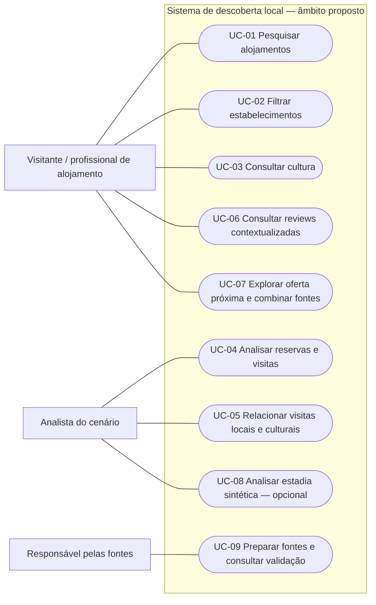

# Requisitos e critérios de aceitação — rascunho P1

Revisão de 02/11/2026. Documento de trabalho para Tiago, Gonçalo e discussão com a professora. Não declara aprovação de stakeholders nem substitui o relatório final. As propostas abaixo não alteram as bases.

## 1. Problema, âmbito e interessados

**Problema:** consultar alojamentos e a respetiva experiência publicada, relacionando-os com oferta de restauração e cultura em Lisboa; demonstrar análise de atividade com um cenário sintético claramente identificado.

**Interessados propostos:** visitante que procura oferta local; profissional de alojamento que informa visitantes; analista que consulta a atividade simulada; equipa que mantém e verifica as fontes. Estes papéis vêm do domínio/proposta, não de entrevistas já realizadas. Professora e colega são interlocutores de validação académica, não substituem automaticamente utilizadores do domínio.

**Fontes:** A1 texto de reviews e metadados, Gonçalo; A2 alojamentos em JSON/MongoDB, Gonçalo; B1 estabelecimentos, pessoas, reservas e visitas em PostgreSQL, Tiago; B2 catálogo cultural em XML/BaseX, Tiago. A implementação atual de A1/A2 deve ser confirmada pelo Gonçalo; as cópias locais são apenas referência.

**Fora do âmbito nesta revisão:** plataforma comercial de reservas, autenticação de clientes, pagamentos, mensagens, disponibilidade em tempo real e prova de comportamento real dos visitantes.

## 2. Estado anterior: onde já existiam requisitos?

- `Projeto/Docs/project_proposal.pdf`, p. PDF 1, §2: necessidades iniciais do grupo, sem IDs ou critérios de aceitação completos.
- `01_modelo.md`, secção «Necessidades antes das tabelas»: ator e perguntas da primeira fonte.
- `04_postgresql_p1.md`, §2: RF1–RF4 locais; é a primeira lista explícita de requisitos funcionais da parte SQL.
- `06_xml_basex_p1.md` e `xml_basex/README_P1.md`: necessidades culturais, consultas e limites.
- Restrições no SQL, XSD, scripts e relatórios já concretizam qualidade, mas não constituíam um catálogo consolidado de requisitos não funcionais.

Os IDs deste documento são **novos IDs consolidados**. O antigo RF1 corresponde a RF-02; RF2 a RF-05; RF3 a RF-04; RF4 a RF-06. Esta revisão não apaga os documentos históricos.

## 3. Requisitos funcionais

| ID | Necessidade verificável | Fonte / caso de uso | Estado e aceitação |
|---|---|---|---|
| RF-01 | Pesquisar alojamentos por localização, capacidade, comodidades e avaliação disponível | A2 / UC-01 | Proposto no âmbito do grupo; confirmar implementação do colega e filtros no seu esquema |
| RF-02 | Consultar estabelecimentos por etiqueta e avaliação publicada mínima | B1 / UC-02 | Implementado: consulta sushi com avaliação >= 4; resultado em `results/p1_activity_queries.json` |
| RF-03 | Consultar lugares culturais por categoria, mostrando identidade, localização e proveniência | B2 / UC-03 | Implementado: 67 museus, 63 monumentos; XQuery e resultados guardados |
| RF-04 | Consultar reservas e visitas distinguindo cancelamento, falta, visita sem reserva e visita associada | B1 / UC-04 | Modelo e verificações implementados; cenário tem exemplos; não se promete interface de criação/edição |
| RF-05 | Analisar por período eventos de visita, presenças acumuladas e pessoas identificadas distintas | B1 / UC-04 | Implementado em consultas de atividade; setembro tem 19 visitas a estabelecimentos e 42 presenças; incluir zeros sem contar acompanhantes como pessoas identificadas |
| RF-06 | Relacionar visitas da mesma pessoa a estabelecimentos e lugares culturais | B1+B2 / UC-05 | IDs culturais verificados na P1; existe demonstração pequena anterior, não a integração global das quatro fontes |
| RF-07 | Consultar texto e contexto temporal de reviews do alojamento correspondente | A1+A2 / UC-06 | Confirmar com o colega; ligação candidata `reviews.listing_id = listing.listing_id`; preservar texto e identidade da review |
| RF-08 | Encontrar estabelecimentos e lugares culturais próximos de um alojamento, com distância e unidade explícitas | A2+B1+B2 / UC-07 | Proposto; raio em metros, coordenadas ausentes sinalizadas; não confundir graus com metros |
| RF-09 | Combinar alojamento, reviews e oferta local numa resposta com proveniência | A1+A2+B1+B2 / UC-07 | Integração P2; definir consulta e resultado esperado em P1; evitar multiplicar contagens ao juntar reviews e visitas |
| RF-10 | Relacionar perfis sintéticos das duas partes e analisar atividade durante uma estadia simulada | Extensão opcional / UC-08 | Só após acordo; exige perfis/estadias sintéticos e correspondências conhecidas, não basta adicionar contactos a anúncios |

**Features/dietas:** constam das necessidades iniciais de descoberta, mas o esquema SQL atual só materializa etiquetas e avaliação. Decidir, a partir de uma consulta prioritária, se se acrescentam funcionalidades e opções alimentares já disponíveis no CSV; não declarar esse filtro implementado antes da carga e dos testes.

## 4. Casos de uso — modelo de trabalho

Não se impõe uma aplicação web em P1: as consultas nos clientes nativos demonstram o acesso às fontes. A representação abaixo identifica intenções do utilizador, não uma interface já construída.

Notação simplificada de casos de uso; não é um diagrama de sequência nem um DER. Há uma versão gráfica editável na terceira página de `09_esboco_aula.drawio`.

### Fluxos mínimos a validar

- **UC-02:** indicar etiqueta e avaliação mínima; filtrar catálogo e devolver IDs, nomes e avaliação publicada. Sem avaliação fica desconhecido, não zero.
- **UC-04:** indicar período `[início, fim[` no fuso de Lisboa e métrica; agregar eventos e manter zeros quando pedidos. Falha da fonte não se apresenta como zero visitas.
- **UC-07:** selecionar alojamento e raio; obter coordenadas válidas, consultar oferta, calcular distâncias e apresentar proveniência. Sem coordenadas, informar que não se consegue avaliar proximidade. Fluxo proposto, não executado no conjunto completo.
- **UC-09:** preparar fonte e consultar relatório; fonte divergente/inválida é recusada ou assinalada, não substituída silenciosamente.

## 5. Requisitos não funcionais / atributos de qualidade

Metas propostas são compromissos a validar, não resultados já medidos. Qualidade do sistema e qualidade dos dados são relacionadas, mas diferentes.

| ID | Atributo e critério de aceitação | Evidência / lacuna |
|---|---|---|
| RNF-01 | Reprodutibilidade: preparação segue README, dependências e comandos; contagens e resultados coincidem com os esperados | Scripts e relatórios locais; falta ensaio do pacote final noutro ambiente |
| RNF-02 | Integridade: identidades únicas, relações locais válidas e exatamente um destino por visita; casos inválidos rejeitados/reportados | PK/FK/CHECK, SQL de qualidade, XSD e testes negativos; nem todas as regras são restrições de escrita |
| RNF-03 | Rastreabilidade: dados externos com origem, versão/data e licença; dados gerados distinguíveis | IDs de origem, hashes e proveniência; extensão sintética deve manter a separação |
| RNF-04 | Correção: cada consulta selecionada tem parâmetros, granularidade, resultado esperado e caso limite | Há oráculos locais; falta fechar a matriz das 12 consultas do grupo |
| RNF-05 | Robustez: fonte indisponível, parsing inválido e referência inexistente não viram resposta vazia válida | Vários erros locais testados; indisponibilidade integrada é trabalho P2 |
| RNF-06 | Privacidade: contactos adicionais explicitamente fictícios; não associar contactos inventados a reviewers reais | Ainda não há contactos pessoais na nossa `person`; usar perfis sintéticos separados |
| RNF-07 | Desempenho demonstrável: registar tempo, volume, versão e condições antes de fixar um limite | Não há SLA nem benchmark global; índices/pushdown só após medir e justificar |
| RNF-08 | Compreensibilidade: glossário, nomes e diagramas coerentes com o esquema executado; propostas separadas | Esta consolidação/esboço ajudam; revisão final e validação pelo grupo pendentes |

Não prometer alta disponibilidade, milhares de utilizadores ou tempos específicos sem necessidade, arquitetura e medição.

## 6. Qualidade dos dados — dimensões e políticas

| ID | Dimensão | Regra / verificação | Situação conhecida |
|---|---|---|---|
| QD-01 | Validade | Tipos, domínios, intervalos e estados reconhecidos | SQL/XSD; coordenada no intervalo válido não prova localização correta |
| QD-02 | Completude | Medir ausências; preservar `NULL`/ausente/`xsi:nil` | B1: 89 pares de coordenadas e 450 avaliações ausentes; B2: contactos incompletos |
| QD-03 | Unicidade | Zero IDs duplicados; não fundir por nome | Nomes repetidos; B2 tem quatro grupos de nomes repetidos |
| QD-04 | Consistência | Reserva/visita coerentes; categoria/prefixo/origem XML concordam | Verificações locais e cenários negativos; estados e datas explícitos |
| QD-05 | Integridade referencial | Toda referência cultural do cenário resolve | Sete visitas verificadas contra BaseX; não há FK SQL entre motores |
| QD-06 | Atualidade e adequação temporal | Mostrar snapshot e data da simulação | B1 de maio de 2021; referência sintética fixa 21/10/2026; não garante oferta atual |
| QD-07 | Exatidão | Não confundir conformidade estrutural com verdade factual | Não verificada abertura atual, contactos operacionais ou todas as coordenadas |
| QD-08 | Cobertura do teste | Regra/consulta prioritária com caso positivo, negativo e ausência relevante | Há testes locais; ampliar para requisitos novos e integração |

## 7. Glossário e regras semânticas

- **Pessoa identificada:** responsável fictício pelo grupo, não todos os acompanhantes nem conta autenticada.
- **Reserva:** intenção/agendamento; pode repetir-se para a mesma pessoa/estabelecimento.
- **Visita:** evento realizado no cenário; reserva opcional e exatamente um destino.
- **Presenças acumuladas:** soma de `party_size`, incluindo acompanhantes e repetições.
- **Review:** texto publicado associado a alojamento/autor; data da publicação não é check-in/check-out.
- **Alojamento / anfitrião / reviewer / hóspede sintético:** conceitos distintos; contacto do anfitrião não identifica reviewer.
- **Preço de referência:** JSON tem montante, moeda e datas de cotação; não é preço universal nem receita de estadias.
- **Proximidade:** relação espacial derivada com raio/unidade; não é identidade entre lugares nem FK obrigatória.
- **Fonte completa para uma pergunta:** hipótese a declarar; zero local não prova inexistência no mundo real.

## 8. Decisões a obter na aula

1. Validar problema, atores e prioridades; registar feedback real com data, sem inventar entrevistas.
2. Confirmar esquema/tecnologia efetivos do Gonçalo em A1/A2.
3. Escolher geografia como eixo principal e decidir se UC-08 justifica perfis/estadias sintéticos.
4. Selecionar 12 consultas: duas individuais por membro mais oito entre subtemas; quatro simples, quatro intermédias e quatro complexas no total.
5. Confirmar evidência de execução cruzada em P1: o enunciado distingue requisitos/resultados esperados em P1 de consultas globais implementadas em P2.

## Referências de base

Enunciado `Projeto/Docs/DMI_Projects_2026_2027.pdf`, pp. PDF 3 (§§2.1–2.4), 4 (§3), 5 (§4), 6 (critérios) e 7 (entrega/IA). Proposta, pp. PDF 1–2. Justificação teórica em `08_auditoria_materia_p1.md`. Texto assistido por Codex/ChatGPT; exige revisão e defesa pelos estudantes.
